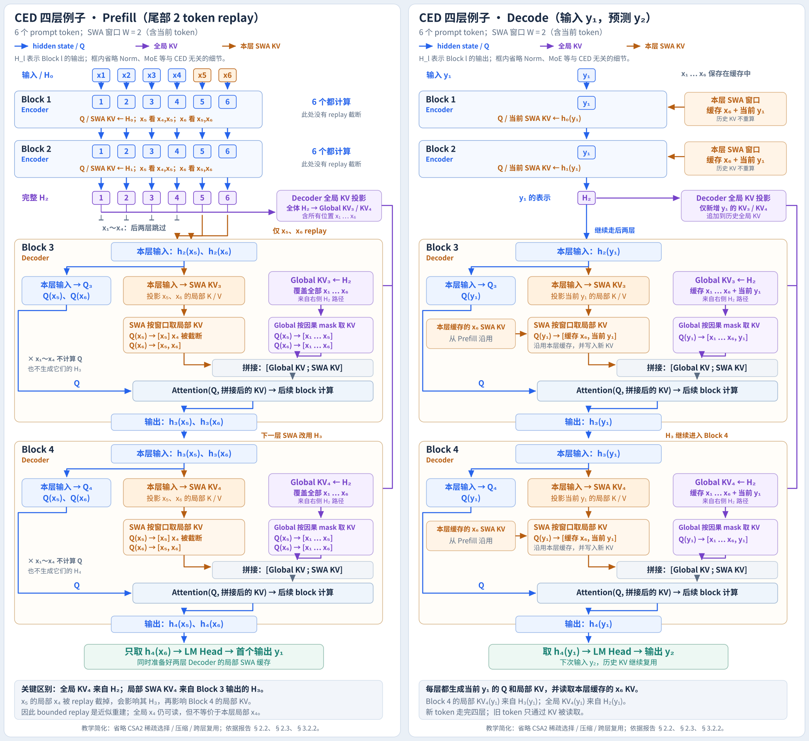

# 从一张信息流图读懂 DeepSeek-V4.1-Flash：CED、SWA 与 KV Cache 压缩

> **作者**：卡兹克  
> **标签**：`AI` | `技术分享`

---

## 新闻现场：为什么一个叫 Flash 的模型，要把 KV Cache 写进标题

2026 年 9 月 10 日，DeepSeek 发布 V4.1 Flash。官方新闻把它概括成“原生多模态、全新非对称结构、能力更强、速度更快、成本更低”。[2] API 公告又补了一层背景：V4.1 Flash 是新模型结构系列中的最小尺寸版本，目标是提高能力上限、推理速度和吞吐，并继续向更大参数规模扩展。[3]

这次发布还有一个很强的产品信号：官方公告称，WorkBuddy（含 CodeBuddy）和 OpenCode 已全量接入 V4.1 Flash；9 月 14 日之后，访问 `deepseek-v4-pro` 的请求也会在 V4.1 Pro 上线前路由到 V4.1 Flash。[3] 一个名叫 Flash 的模型接替更大的 Pro，背后的关键问题就变得具体了：**它怎样在保持大模型能力的同时，把长上下文 Agent 的成本压下来？**

把场景放进一次工具调用就容易理解了。Agent 可能带着几万 token 的代码、工具返回和历史轨迹发起请求，只生成几十到几百个新 token。每调用一次工具，服务端都要重新处理长 Prompt，还要在 HBM、主机内存和 SSD 之间保存、迁移和恢复 KV Cache。输入越长，系统越像是在反复搬运一座越来越大的仓库。

DeepSeek-V4.1-Flash 的技术报告正面回答了这个问题：552B backbone、最长 100 万 token 上下文，却让每个 token 在 Prefill 阶段激活约 8B 参数，在 Decode 阶段激活约 16B 参数。[1] CED（Causal Encoder-Decoder）减少长 Prompt 的 Prefill 计算，CSA2（Compressed Sparse Attention 2）减少全局 KV 的重复保存和索引开销，FP4 压缩每个 KV entry 的字节数，SWA Bounded Replay 则用有限重放恢复局部注意力状态。

下面先用一张四层网络的图把信息流讲清楚，再把它映射到论文里的真实配置。



## 先读懂图里的三种箭头

图中采用 6 个输入 token：`x₁ ... x₆`。为了让路径足够清楚，示例网络只有四层：Block 1、Block 2 是 Causal Encoder，Block 3、Block 4 是 Decoder。SWA 窗口设置为 2，窗口包含当前 token。

蓝色路径表示 hidden state 和 query 的流动。紫色路径表示全局 KV，橙色路径表示本层的局部 SWA KV。每个 Decoder block 都把两种 KV 拼在一起，再交给一次注意力计算：

```text
Q_l = q_l(H_{l-1})
Global KV_l = g_l(H_2)
SWA KV_l    = s_l(H_l)

Attention_l = Attention(Q_l, [Global KV_l ; SWA KV_l])
```

最后一行是教学化写法，真实实现还会叠加压缩、稀疏索引和因果 mask。它保留了最重要的结构关系：**全局 KV 的来源固定在中间层 H₂，SWA KV 的来源跟着当前层走。**

## CED 解决的是 Prefill 的长序列计算

普通的四层因果 Transformer 会让所有 token 依次经过四个 block：

```text
x₁ ... x₆ → Block 1 → Block 2 → Block 3 → Block 4
```

如果 Prompt 长度是 N，层数是 L，简化后可以把 Prefill 工作量写成 (O(NL))。这个写法没有展开每个 Attention kernel，也没有计入稀疏注意力的具体常数，但它准确表达了一个事实：每增加一层，完整 Prompt 就要再走一遍。

CED 把网络沿深度分成两段。下半段保留完整的 causal 计算，得到中间 hidden states (H_{L/2})。对于上半段的全局注意力，模型不再从各自的 (H_l) 生成 KV，而是使用层相关的投影：

[
C^l = H_{L/2}W_l^{KV}, qquad Z^l = H_{L/2}W_l^Z,qquad l>L/2.
]

这里的“共享”指共享输入来源 (H_{L/2})，每个 decoder 层仍保留自己的投影参数 (W_l^{KV}) 和 (W_l^Z)。因此 CED 没有把上半层变成同一个注意力层，也没有抹掉层间差异。[1]

对全局分支来说，长 Prompt 只需完整通过前半层；上半层的全局 KV 可以从 (H_{L/2}) 直接投影得到。报告将 Prefill 复杂度写成：

[
O(NL/2+n_{win}L/2)≈O(NL/2),qquad Ngg n_{win}.
]

第二项来自局部 SWA 的重放。只要上下文足够长，(n_{win}) 相比 N 很小，Prefill 的主要工作就接近减半。[1]

## 四层例子：为什么 x₁ 到 x₄ 可以停在 H₂

在图的 Prefill 左半边，6 个 token 都经过 Block 1 和 Block 2，于是得到：

```text
H₂ = [h₂(x₁), h₂(x₂), h₂(x₃), h₂(x₄), h₂(x₅), h₂(x₆)]
```

这 6 个位置都会参与全局 KV 投影：

```text
H₂ ──投影──> Global KV₃：覆盖 x₁ ... x₆
H₂ ──投影──> Global KV₄：覆盖 x₁ ... x₆
```

因此 x₁ 到 x₄ 没有消失。它们跳过的是 Block 3、Block 4 的完整 hidden-state 前向，仍然通过 Global KV 为 x₅、x₆ 的查询提供长距离上下文。

x₅ 和 x₆ 继续进入 Decoder，是因为模型还要为它们生成 Decoder 层自己的局部 SWA 状态。Block 3 产生 (h_3(x_5)) 和 (h_3(x_6))，Block 4 再用这些表示生成对应的局部 KV 和输出表示。

这个过程可以写成：

```text
x₁ ... x₆ ──> H₂ ──> Global KV₃ / Global KV₄
                  └─> 只把 x₅、x₆ replay 到 Block 3、Block 4

Block 3:
  Q₃(x₅), Q₃(x₆)
  读取 Global KV₃
  读取本层 SWA KV₃
  输出 h₃(x₅), h₃(x₆)

Block 4:
  Q₄(x₅), Q₄(x₆)
  读取 Global KV₄
  读取本层 SWA KV₄
  输出 h₄(x₅), h₄(x₆)
```

Prefill 完成后，模型取最后位置的表示 (h_4(x_6))，经过 LM Head 产生第一个输出 token (y_1)。图中把它画在 Prefill 的底部。下一步 Decode 才把 (y_1) 作为新输入，预测 (y_2)。

## SWA 为什么必须单独画出来

全局 KV 和 SWA KV 的来源不同。

全局注意力希望访问很长的上下文，CED 让它从 (H_2) 直接生成。SWA 则保留每层自己的局部路径：

[
K_l^{SWA},V_l^{SWA}=s_l(H_l).
]

在图中，Block 3 的 SWA KV₃ 来自 (h_2(x_5))、(h_2(x_6))，Block 4 的 SWA KV₄ 来自 (h_3(x_5))、(h_3(x_6))。这就是为什么图里必须把 Block 3 的输出画到 Block 4 的局部 KV 生成器上。

SWA 窗口为 2 时，图中采用的 bounded replay 让 Block 3 的局部读取变成：

```text
Q₃(x₅) → [x₅]       x₄ 的局部状态被截断
Q₃(x₆) → [x₅, x₆]
```

Global KV₃ 仍能让 x₅ 读取全局范围内的 x₁ 到 x₅，但 Global KV₃ 不能等价替代本层的局部 SWA KV₃(x₄)。因此 bounded replay 产生的是近似的局部状态。报告明确把这种方法定义为近似重建，并通过训练适配和实验验证其质量影响。[1]

报告给出的 Decoder SWA Bounded Replay 做法是：Prefill 时只把 Prompt 最后 (n_{win}) 个 token 的 encoder outputs 送入 decoder 层，在相同的 SWA 截断规则下生成 Decoder SWA KV；这些状态用于随后 Decode，但不进入 Prefix 的持久化缓存。[1]

这解释了图中两个看起来容易矛盾的事实：

- x₁ 到 x₄ 能跳过 Decoder 的完整前向，却仍然进入全局 KV；
- x₅、x₆ 需要 replay，因为 Decoder 的局部 SWA KV 必须从本层 hidden states 生成。

## Decode 阶段：每个新 token 仍然走完整网络

Decode 处理的是一个新 token，而不是整段 Prompt。图的右半边把 (y_1) 作为当前输入：

```text
y₁ → Block 1 → Block 2 → Block 3 → Block 4 → LM Head → y₂
```

历史 x₁ 到 x₆ 不会重新经过 block。它们已经写入缓存，当前 token 的 query 直接读取缓存中的 KV。

在 Block 3 中，当前 (y_1) 同时读取两部分信息：

```text
Global KV₃：x₁ ... x₆ + 当前 y₁ 的全局 KV
SWA KV₃：  缓存的 x₆ 局部 KV + 当前 y₁ 新生成的局部 KV
```

Block 4 的局部 KV 来自 (h_3(y_1))，而全局 KV₄ 在 CED 中仍从 (H_2(y_1)) 的路径得到。模型让每一层保留自己的局部计算深度，同时把长上下文的全局缓存从逐层生成改成中间层投影。

## 真实模型不是四层，而是 20 层 Encoder 加 20 层 Decoder

四层图只为了展示信息流。DeepSeek-V4.1-Flash 的语言 backbone 有 40 层，20 层 Causal Encoder 加 20 层 Decoder，hidden dimension 为 5120。[1]

论文给出的注意力配置比教学图复杂得多：

- Encoder 的前两层使用纯 SWA；后 18 层使用 CSA2，压缩率为 2。
- 18 层 Encoder CSA2 分成 3 组，每组 6 层。每组第 1 层是 Full Mode，后 5 层是 Reuse Mode。
- Decoder 的 20 层使用 CSA2，压缩率为 1。20 层分成 5 组，每组 4 层。第 1 组是 1 个 Full Mode 加 3 个 Reuse Mode，后 4 组是 1 个 Reindex Mode 加 3 个 Reuse Mode。
- 每层使用 64 个 query heads，indexer 使用 32 个 query heads，Top-K 为 512。
- Hierarchical Sparse Indexer 最多选择 2048 个 block，每个 block 包含 8 个位置，因此后续 indexer 的候选池最多约 16384 个位置。
- SWA 窗口 (n_{win}=128)。

这些配置说明了一个重要关系：**CED 负责把 Decoder 的全局 KV 生成锚定到 Encoder 末端，CSA2 再负责跨层复用这些全局表示和稀疏选择。**

## CSA2：在层、序列和 entry 大小三个方向压缩

长上下文 KV Cache 的大小可以从三个方向压缩：

1. **Entry 维度**：减少 KV head，或用 latent 表示多个 head。
2. **序列维度**：把多个 token 压缩为一个 KV entry。
3. **层维度**：让多个层复用同一份 main KV、indexer K 或 Top-K 选择。

CSA2 重点处理第三个方向，同时结合序列压缩和稀疏注意力。它为每层安排三种模式：

### Full Mode

Full 层生成 main KV、indexer K，并计算新一轮 Top-K 索引。它承担一次完整的全局 KV 和稀疏路由建立。

### Reindex Mode

Reindex 层复用最近的 main KV 与 indexer K，但使用自己的 indexer Q 重新打分，得到新的 Top-K。这样可以改变注意力选择，保持层间差异。

### Reuse Mode

Reuse 层同时复用 main KV 和最近一次得到的 Top-K，跳过新的 indexer Q 和索引打分。

把这三种模式放回四层教学图，就能看出一个简化关系：图里单独画出的 Global KV₃、Global KV₄帮助理解 CED；真实 V4.1 的 CSA2 会让后续层复用或重索引这些全局组件，而不是每层都从头生成一份完整的全局缓存。[1]

Decoder 还使用 Hierarchical Sparse Indexer。第一个 Full 层扫描可见上下文，除了选出自己的 Top-K，还按 block 的最高分建立候选池。后续 Reindex 层只在这个候选池里重新打分，Reuse 层继续沿用已有选择。这样，第一次索引仍然需要看完整上下文，后续索引的工作量与上下文长度近似解耦。[1]

## FP4 与 SWA 的精度分工

CED 和 CSA2 减少了需要保存的 KV 数量，FP4 则进一步减少每个 entry 的存储字节数。

V4.1 对 main KV 使用 OCP MXFP4，通过量化感知训练适配 FP4 cache；attention 前再反量化，因此 FP4 的主要作用是省存储，不要求硬件直接用 FP4 完成最终矩阵乘法。报告选择 E2M1，并为每 16 个 channel 配置一个 E4M3 scale。[1]

SWA KV 仍然使用 FP8。原因很直接：局部 SWA 状态对精度更敏感。报告明确说明，V4.1 保留 FP8 作为 SWA KV 的格式。[1]

这对应图里的两种状态：

```text
Global KV：数量多、寿命长，适合用 FP4 压缩并放进 HBM / SSD
SWA KV：   局部依赖敏感，保留 FP8，并通过 replay 避免长期持久化
```

## 缓存系统：把 HBM、主机内存和 SSD 分工

报告给出的目标不是单纯减少一次 forward 的 FLOPs，而是同时降低缓存容量和数据搬运压力。

V4.1 的 global KV 常驻持久化缓存，SWA KV 不再以同样的方式长期写入持久化缓存。SWA 状态更适合短 TTL 的分布式内存池；发生 miss 时，系统使用 Encoder SWA Bounded Replay 或 Decoder SWA Bounded Replay 重新生成最近窗口的局部状态。[1]

报告摘要给出三个数字：

- global KV footprint：890 bytes/token，约为 DeepSeek-V4-Flash 的 1/4；
- persistent KV footprint：通过 SWA Bounded Replay 降到约 1/8；
- Prefill 的激活参数量约 8B，Decode 约 16B。[1]

这三个数字衡量的对象不同。890 bytes/token 衡量 global KV 的运行时缓存占用；1/8 衡量持久化 KV 的整体占用；8B/16B 衡量不同阶段每个 token 激活的模型参数量。把它们放在一起看，V4.1 同时压缩了计算路径、运行时 HBM 和长期缓存。

## 其他扩展：模型容量、激活计算和服务吞吐

CED、CSA2、FP4 解决的是长上下文主路径。V4.1 还叠加了几项工程优化：

- **DeepSeekMoE**：backbone 总参数很多，每个 token 只路由到少数专家，从而把参数容量和单 token 计算分开。
- **Single-Pass mHC**：把 residual stream mixing、系数预测和归一化做 kernel 级融合，减少 activation memory traffic。
- **Engram**：使用稀疏访问的条件记忆，把部分记忆能力放进大规模 embedding table，减少让主干网络反复“背诵”的压力。模型为 Engram 分配了 196B 参数。[1]
- **DSpark**：单独训练的 speculative decoding 模块，一次草拟多个位置，再根据置信度调节验证长度，目标是提高系统吞吐。[1]

这些模块与 CED 的关系可以这样理解：CED 改变长 Prompt 的信息流，CSA2 和 FP4 改变 KV 的表示与存储，mHC、Engram、DSpark 分别从 kernel、记忆和生成调度层面继续压低成本。

## 这个设计的代价

CED 把计算省在了最贵的长 Prompt 全局路径上，但它带来三类代价。

第一，Decoder 的局部 SWA 状态需要 replay。Bounded Replay 截断了理论依赖，得到的是近似状态。论文报告质量影响很小，但这不是数学上的精确重建，系统需要用训练阶段的 replay 适配和线上评估来控制风险。[1]

第二，CSA2 让运行时状态之间存在跨层依赖。Full、Reindex、Reuse 三种模式需要共享 main KV、indexer K 和 Top-K 状态，训练和推理框架都要管理这些生命周期。论文为跨 pipeline stage 的共享状态引入了 shadow indexer、payload 扩展和 micro-batch 级状态管理。[1]

第三，第一层 Full Mode 的 indexer 仍需扫描完整可见上下文。Hierarchical Sparse Indexer 主要降低后续 indexer 的工作量，不能把第一次全范围扫描也消掉。[1]

## 用一句话总结整套架构

DeepSeek-V4.1-Flash 把长上下文服务拆成四个互相配合的动作：

```text
CED：     用 H₍L/2₎ 生成上半层全局 KV，减少 Prefill
CSA2：    跨层复用 KV 与稀疏索引，减少缓存和索引计算
FP4：     压缩 main KV 的每 entry 字节数，减少 HBM / SSD 压力
SWA Replay：只重放最近窗口，恢复局部 KV，避免长期保存 SWA cache
```

四层 SVG 图里的主线因此可以压缩成一句工程判断：**长距离信息走可复用的全局 KV，短距离信息走逐层 SWA；CED 让两条路径在不同深度上承担不同工作，CSA2、FP4 和 bounded replay 再把缓存容量、带宽与重建成本压到部署可以承受的范围。**

## Sources

[1] /Users/a58/Downloads/DeepSeek_V41_Tech_Report.pdf - DeepSeek-V4.1-Flash: Pushing the Limits of KV Cache Compression（用户提供的技术报告）
[2] https://www.deepseek.com/news/deepseek-v4-1-flash - DeepSeek 官方新闻：DeepSeek V4.1 Flash
[3] https://api-docs.deepseek.com/zh-cn/news/news260910 - DeepSeek API Docs：DeepSeek V4.1 Flash 新闻